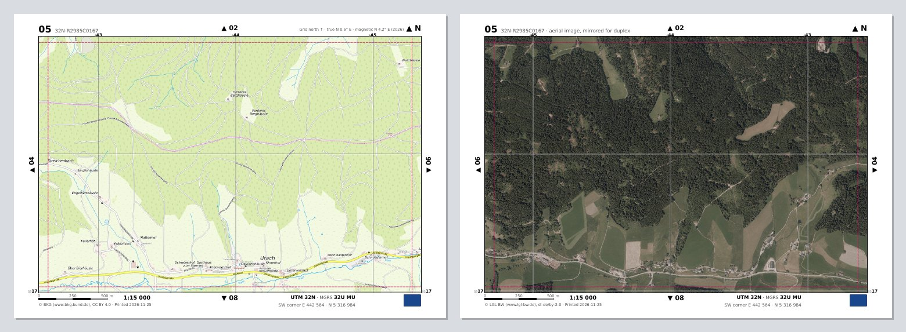

# Kartenwerk – printable duplex map series, anywhere in the world



*Example sheet (A5, 1:15 000, Black Forest): front and mirrored back.
[PDF](examples/Sheet_05_32N-R2985C0167.pdf) · map data © BKG (CC BY 4.0) and
© LGL BW (dl-de/by-2-0).*

A QGIS plugin that turns a work area into landscape map sheets (A2, A3, A4 or
A5) at a selectable scale (default 1:15 000), ready for double-sided printing:

- **Front:** a topographic map with a 1 km UTM grid, numbered in the border.
  The border also carries the sheet number, a scale bar, grid/true/magnetic
  north, the UTM zone and MGRS square, neighbour sheets, a locator diagram,
  attribution and print date; the map itself stays free of text. Your own
  layers, such as a GPX route, can be drawn on top.
- **Back:** the same extent as aerial imagery, **mirrored horizontally**, so the
  back can be printed duplex and held up against the light in register with
  the front.
- **Selection:** draw a work area, generate a sheet grid buffered by one cell,
  then pick the sheets you actually want to print.
- **Worldwide:** coordinates are always metric WGS 84 / UTM with the zone chosen
  automatically. Basemaps default to worldwide sources and switch to better
  national services automatically where they exist.

---

## Coordinate system: WGS 84 / UTM

Every map series uses **WGS 84 / UTM** (EPSG:326zz north of the equator,
EPSG:327zz south), the worldwide standard for metric topographic map grids.

- The zone (1–60) is chosen from the centre of the work area, e.g. 32N for
  Stuttgart, 13N for Colorado, 54N for Hokkaido, 56S for Sydney.
- Coordinates are easting/northing in metres, printed with spaces as thousands
  separators (`UTM 32N · SW E 435 600 / N 5 317 600`).
- The 1 km grid lines are true UTM kilometre lines, so they also match GPS
  devices set to UTM and MGRS grids.
- The grid origin is fixed at E 0 / N 0 of the zone, so sheet IDs stay stable
  between runs. A sheet ID like `32N-R1564C0088` is zone 32N, row 1564,
  column 88.
- In Europe WGS 84 and ETRS89 differ by less than 1 m, so the coordinates match
  official ETRS89/UTM maps.
- If a work area reaches more than 3° beyond its zone you get a warning (scale
  distortion grows slowly); polar areas beyond 84° N / 80° S are not supported.

---

## Basemap sources

**Automatic** (the default) picks the most specific source whose coverage
contains the selected sheets. If a national service still leaves a sheet
largely empty (the coverage boxes are coarse), that sheet falls back to the
worldwide source and its attribution is adjusted.

| Side | Source | Coverage | Licence / terms |
|---|---|---|---|
| Front | OpenTopoMap | worldwide (default) | CC-BY-SA, © OpenStreetMap contributors. [Fair-use tile policy](https://opentopomap.org/about): avoid very large batch exports. |
| Front | TopPlusOpen | Germany | © BKG, CC BY 4.0 |
| Front | swisstopo national map | Switzerland | © swisstopo |
| Front | USGS Topo | USA (incl. AK, HI) | public domain |
| Back | Esri World Imagery | worldwide (default) | Check [Esri's terms of use](https://www.esri.com/en-us/legal/terms/full-master-agreement); attribution required. |
| Back | DOP20 | Baden-Württemberg | © LGL BW, dl-de/by-2-0 |
| Back | DOP40 | Bavaria | © Bayerische Vermessungsverwaltung, CC BY 4.0 |
| Back | PDOK Luchtfoto | Netherlands | © Beeldmateriaal Nederland, CC BY 4.0 |
| Back | IGN orthophotos | France | © IGN, Licence Ouverte 2.0 |
| Back | SWISSIMAGE | Switzerland | © swisstopo |
| Back | basemap.at Orthofoto | Austria | © basemap.at, CC BY 4.0 |
| Back | USGS Imagery | USA | public domain |

You can also pick any source for either side, or any raster layer you added to
the project (e.g. your own WMS, a GeoTIFF, a national service not listed here).
Esri imagery is limited to zoom level 17, the highest level with real tiles
almost everywhere; in some remote areas Esri's imagery itself is coarse.

New sources are added in `plugin/kartenwerk/sources.py` (one `Source(...)`
entry with URL, coverage box and attribution).

---

## Requirements

- **QGIS 3.28+** on Linux, Windows or macOS (tested with QGIS 3.44 headless).
- Internet access to the basemap services.
- Optional: **pdfunite** (poppler-utils) or **Ghostscript** to also get one
  merged `all_sheets.pdf`. Each sheet PDF is complete without them.

The plugin uses only PyQGIS; no additional Python packages are needed.

---

## Installation

**From a GitHub release (easiest):** download `kartenwerk.zip` from the
repository's [Releases](https://github.com/Andoxtra/QGIS_Kartenwerk/releases)
page, then in QGIS: **Plugins → Manage and Install Plugins → Install from
ZIP**.

**Build the ZIP yourself (any platform):**

```bash
python3 install_plugin.py --zip        # writes kartenwerk.zip
```

**Publishing a release** (maintainers): set `version=` in
`plugin/kartenwerk/metadata.txt`, commit, then push a matching tag, e.g.
`git tag v2.2.0 && git push origin v2.2.0`. The `release` workflow checks that
tag and version match, runs the offline tests, builds `kartenwerk.zip` and
publishes it as a GitHub release.

**From the QGIS plugin repository:** not published yet. The plugin folder
contains metadata, icon and LICENSE; before uploading, fill in `email=` in
`plugin/kartenwerk/metadata.txt`, build the ZIP and upload it with an OSGeo
account. Note: QGIS asks plugins in its repository to comply with GPL v2 or
later. The Unlicense is generally regarded as GPL-compatible, but reviewers may
still ask for a GPL licence.

**Into a profile (for development):** close QGIS, then

```bash
python3 install_plugin.py              # last-used profile; symlink (copy on Windows)
python3 install_plugin.py --profile default --copy --force
```

This links/copies `plugin/kartenwerk` into the profile's `python/plugins`
folder and sets `kartenwerk=true` in the profile's `QGIS3.ini`. Restart QGIS;
the plugin appears under **Plugins → Kartenwerk** and as a toolbar and dock.

---

## Quick start

1. Open a QGIS project (or `kartenwerk.qgz`, see below) and save it. The
   plugin stores its GeoPackage (`kartenwerk.gpkg`) and the default `output/`
   folder next to the project. Without a saved project they go to
   `<QGIS profile>/kartenwerk/`.
2. **Draw work area** – in an empty project this first adds OpenTopoMap so
   you can see where you are; zoom to your area (the search bar at the bottom
   left finds place names). Draw a polygon, finish with right-click, save with
   `Ctrl+S`.
3. **Generate grid** – creates sheet cells in the work area's UTM zone,
   buffered by one cell. The project CRS switches to that zone so the grid
   appears square. The cell size follows page format, scale and overlap (e.g.
   2.65 × 1.78 km for A5 at 1:15 000 with 5 % overlap).
4. **Select sheets** – click cells; use `Ctrl` / `Shift` for several.
5. Optional: **Number sheets** – numbers the selected sheets north → south,
   west → east. **Name sheet** – gives one selected sheet a name (e.g. a
   village), shown in the title, the overview and `index.csv`. Regenerating
   the grid keeps numbers and names as long as page format, scale and overlap
   are unchanged; automatic numbering on export only fills gaps.
6. **Export selection** – writes the PDFs to the output folder.
7. Print – see [Printing](#printing).

The dock shows page format, scale and UTM zone, plus the current selection
count.

---

## Settings

**Map tab**

| Setting | Default | Description |
|---|---|---|
| Page format | `A5` | `A2`, `A3`, `A4` or `A5` landscape. Regenerate the grid after changing it. |
| Scale | `1:15 000` | `1:10 000` – `1:25 000`. A smaller denominator gives larger, more readable text but less area per sheet. |
| Sheet overlap | `5 %` | None, 5 % or 10 %. Neighbouring sheets share this strip; a dashed line marks where the next sheet begins. Regenerate the grid after changing it. |
| Front (map) / Back (imagery) | Automatic | Automatic, a catalog source, or a raster layer from the project. The dialog shows what Automatic picks for the current work area. |
| Overlays | none | Your own vector layers (e.g. a GPX route, waypoints), drawn on top of the map with their QGIS style. Optionally also on the back, without labels (they would be mirrored). Saved in the project. |

**Printing tab**

| Setting | Default | Description |
|---|---|---|
| Output folder | `<project folder>/output` | Leave empty to follow the project. |
| Printer margin | `5 mm` | Nothing is printed closer to the paper edge. 4 or 3 mm give a bigger map if your printer can print that close (test with one sheet). Regenerate the grid after changing it. |
| Resolution (dpi) | `300` | Render and PDF resolution. |
| Front/Back format | `PNG` | `PNG` (lossless) or `JPEG` (faster, smaller). |
| JPEG quality | `92` | 50–100. |
| Two sheets per page | off | Also writes a print file with two sheets stacked on the next larger paper (A5 → A4, A4 → A3, A3 → A2) with cut marks. Not available for A2. |
| Duplex offset | 0 / 0 mm | Moves all back-side content to compensate a printer's duplex shift; separate values for the sheet PDFs and the two-per-page file. See [Printing](#printing). |

**Advanced tab**

| Setting | Default | Description |
|---|---|---|
| Front/Back attribution | automatic | Leave empty to print the source's own attribution. |
| Number sheets automatically | on | Numbers unnumbered selected sheets on export; existing numbers are kept. |
| Open output folder | on | Opens the folder after a successful export. |
| Keep downloaded maps | on | Render cache: rendered map images are kept for 30 days (max. 1 GB), so exporting a sheet again downloads nothing. Esri imagery is never stored, as its terms don't allow it. **Clear cache** shows the size and empties it. |

**Refresh** reloads the layer lists; **Swap** swaps front/back basemap, format
and attribution. Settings are stored under `kartenwerk/*` in the QGIS
settings, overlays in the project.

---

## Output

**Example:** [`examples/Sheet_05_32N-R2985C0167.pdf`](examples/Sheet_05_32N-R2985C0167.pdf)
is one exported sheet (Black Forest, A5, 1:15 000, 300 dpi, 5 % overlap): the
TopPlusOpen topographic map on the front and the DOP20 aerial image, mirrored,
on the back. Its map content is licensed by BKG and LGL BW, see
[NOTICE.md](NOTICE.md).

```
output/
├── Overview.pdf                    # sheet overview (north up) + list of all sheets
├── Sheet_01_32N-R1564C0088.pdf     # 2 pages: front topo, back mirrored imagery
├── Sheet_02_32N-R1564C0089.pdf
├── all_sheets.pdf                  # overview + all sheets (needs pdfunite or Ghostscript)
├── Print_2-per-page_A4.pdf         # optional: two sheets per A4 page, for home printers
└── index.csv                       # comma-separated, UTF-8
```

`index.csv` columns:

```
sheet,sheet_id,utm_zone,epsg,name,e_min,e_max,n_min,n_max,file
```

Temporary images are written to the system temp folder and deleted after each
sheet.

---

## Sheet geometry

Nothing is printed closer to the paper edge than the **printer margin**
(Settings → Printing; 5 mm by default, the area most printers cannot reach; 4 or
3 mm give a bigger map on printers that can print closer to the edge). Inside
it, the border on A5 has lanes of 7 mm left and right (equal, so the mirrored
back registers with the front), 6 mm at the top and 7 mm at the bottom. On
larger pages the border text and lanes grow with the page (A4 × 1.15,
A3 × 1.35, A2 × 1.6), so they stay in proportion. One grid cell is the map
frame at the chosen scale minus the overlap. A5 at 1:15 000 with 5 % overlap:

| Printer margin | Map frame | Ground shown per sheet | Grid step (new ground per sheet) | 300 dpi map image |
|---|---|---|---|---|
| 5 mm (default) | 186 × 125 mm | 2 790 × 1 875 m | 2 650.5 × 1 781.25 m | 2 197 × 1 476 px |
| 4 mm | 188 × 127 mm | 2 820 × 1 905 m | 2 679 × 1 809.75 m | 2 220 × 1 500 px |
| 3 mm | 190 × 129 mm | 2 850 × 1 935 m | 2 707.5 × 1 838.25 m | 2 244 × 1 524 px |

The grid is always 1 km = 66.7 mm at 1:15 000. Changing the printer margin
changes the cell size, so regenerate the grid afterwards.

---

## Printing

1. **Print at actual size.** Choose "Actual size" / 100 % and switch off "Fit
   to page" or "Shrink oversized pages", otherwise the scale is wrong.
2. **Check the scale on the first print.** One grid square must measure:

   | Scale | 1 km on paper |
   |---|---|
   | 1:10 000 | 100 mm |
   | 1:12 500 | 80 mm |
   | 1:15 000 | 66.7 mm |
   | 1:20 000 | 50 mm |
   | 1:25 000 | 40 mm |

   If the page was scaled anyway, the scale bar is still correct.
3. **Duplex setting.** The paper must turn over **like a book page, left to
   right**, so each back lands behind its front. What the printer calls this
   depends on the driver:
   - single sheet PDFs (landscape pages): usually **"flip on short edge"**,
   - the two-per-page print file (portrait pages): usually **"flip on long
     edge"**.

   A mirrored or upside-down back means the other flip setting.
4. **Duplex offset.** Most duplex printers shift the back by 1–2 mm. Settings →
   Printing → **Create duplex test pages** writes `Duplex_test_A5.pdf` (and
   `Duplex_test_2-per-page_A4.pdf`). Print it double-sided like the maps, hold
   it against a window and look at the **back**: read where the front's cross
   shows through on the back's millimetre rulers (+ = right, + = down) and
   enter both values as the duplex offset. The test pages are always printed
   without offset, so a new reading simply replaces the old value. The two
   files need separate values because printer drivers rotate landscape and
   portrait pages differently.
5. **Paper.** A5 sheets need A5 paper in the printer, or switch on **Two
   sheets per page** and print the `Print_2-per-page_A4.pdf` file on A4, then
   cut along the cut marks at the middle of the page. For field use, 100–120
   g/m² paper (or waterproof paper) holds up better than standard 80 g/m².
6. **Large series.** Print a test sheet before printing everything; most
   problems (scale, duplex, cut-off text) show on the first page.

---

## Front / back details

The border, from top to bottom:

- **Top:** sheet number (large) and sheet ID; north neighbour; north arrow with
  the angles from grid north to true north (grid convergence) and to magnetic
  north (declination from NOAA's World Magnetic Model 2025, valid 2025–2030;
  omitted outside that period). The magnetic angle is what a compass user needs.
- **Km labels** at every 1 km grid line: eastings along the top, northings on
  both sides, UTM style: small leading digits + bold kilometre, e.g. `⁴36` =
  E 436 000, `⁵³18` = N 5 318 000.
- **Sides:** west/east neighbours, rotated to read upwards. A numbered
  neighbour shows its number (`▲ 04`), an unselected one its short ID in grey,
  a missing one `—`.
- **Bottom:** scale bar (stays correct even if the page is printed scaled) and
  scale; south neighbour; UTM zone and MGRS 100 km square (e.g. `32U MU`, or
  `32U MU / NU` when a sheet spans two squares — left out in the Norway and
  Svalbard MGRS exception zones); a locator diagram showing the sheet (dark
  blue) within the exported series (light blue); attribution, print date and
  the SW corner of the printed map. For series larger than 8 × 8 sheets the
  locator shows the 8 × 8 sheets around the current one, and small grey
  triangles on its sides mark where the series continues.
- A thin black frame line surrounds the map.

**What the dashed red lines in the map mean:** with sheet overlap switched on
(default 5 %), each sheet shows a little more ground than its own grid cell, so
paths near an edge also appear on the next sheet. The dashed red lines mark
**where the neighbouring sheet begins**; the narrow strip between a dashed line
and the black frame is printed on the neighbour as well. When you walk off a
sheet, switch to the neighbour once you cross the dashed line. They are not
cut lines. With **Sheet overlap: None** they disappear and the sheets meet
exactly at the frame.

The back image (basemap and grid lines) is flipped in memory with
`QImage.mirrored(True, False)` before it is saved; all border text is drawn
unflipped, so it stays readable. On the back the left/right neighbours, the
easting labels and the locator are mirrored to match the image; the north block
shows only the arrow, since angles measured on a mirrored image are reversed.

---

## Project layout

```
QGIS_Kartenwerk/
├── kartenwerk.qgz              # example QGIS project
├── kartenwerk.gpkg             # work area (+ generated grid)
├── examples/                   # an example sheet PDF (map data © BKG / LGL BW)
├── setup_project.py            # rebuild the project (keeps work-area polygons)
├── install_plugin.py           # install into a QGIS profile / build ZIP
├── plugin/kartenwerk/
│   ├── plugin.py               # toolbar, dock, actions
│   ├── dialog.py               # settings dialog
│   ├── config.py               # geometry, paths, settings
│   ├── crs.py                  # UTM zone selection, grid convergence, MGRS squares
│   ├── wmm.py, WMM2025.COF     # World Magnetic Model (magnetic declination)
│   ├── cache.py                # render cache (never used for Esri imagery)
│   ├── icon.png, LICENSE       # plugin icon, Unlicense (code is public domain)
│   ├── NOTICE.md               # what is public domain and what is not (map data)
│   ├── sources.py              # basemap catalog + automatic selection
│   ├── services.py             # layer-tree helpers, default basemaps
│   ├── grid.py                 # work area, grid, numbering, neighbours
│   ├── render.py               # map rendering, grid lines, mirroring
│   ├── layout.py               # two-page layout, PDF export, overview
│   └── exporter.py             # batch export, merge, index.csv
└── dev/                        # tests
```

`setup_project.py` recreates `kartenwerk.qgz` (worldwide basemaps, themes
`Topo`/`Imagery`, layout `Kartenwerk`) without deleting work-area polygons.

### Upgrading from version 1 (Baden-Württemberg only)

- Work-area polygons in the old `arbeitsgebiet` table are copied into the new
  `work_area` layer automatically; old projects keep working.
- Old grids (`raster`, EPSG:25832) have no UTM zone in their sheet IDs: run
  **Generate grid** again before exporting.
- Old settings (front/back layer, attribution text) are reset once.
- The old `Vorderseite`/`Rueckseite` layouts are replaced by one two-page
  layout `Kartenwerk`.
- Automatic now uses TopPlusOpen for the front inside Germany. Choose
  **OpenTopoMap** in the settings to keep the previous look.

---

## Tests

Offline (no QGIS needed): UTM zones, source selection, MGRS letters (against
documented reference values) and the magnetic model (all 100 NOAA test values):

```bash
python3 dev/test_zones.py
```

End-to-end export for several regions (needs PyQGIS and internet; writes to
`dev/out/`):

```bash
QT_QPA_PLATFORM=offscreen python3 dev/test_core.py            # bw nl us jp nz fallback lu bz westland
QT_QPA_PLATFORM=offscreen python3 dev/test_core.py bw nl      # selected regions
QT_QPA_PLATFORM=offscreen python3 dev/test_core.py --offline  # no downloads: layout, scale, safe zone,
                                                              # duplex offset, cache, overlays, numbering
QT_QPA_PLATFORM=offscreen python3 dev/test_ui.py              # dock, actions and settings dialog
```

Without a local QGIS, use the official Docker image:

```bash
docker run --rm -u $(id -u):$(id -g) -e HOME=/tmp -v "$PWD":/work -w /work \
  qgis/qgis:ltr python3 dev/test_core.py
```

**GitHub Actions** (`.github/workflows/tests.yml`) runs `test_zones.py`,
`test_core.py --offline` and `test_ui.py` on every push and pull request. The end-to-end export
downloads real map tiles, so it only runs on demand: Actions → tests → Run
workflow → tick "Also run the end-to-end export test". Its PDFs are attached to
the run.

---

## Licence

**The code is public domain** under the [Unlicense](LICENSE): use, copy,
modify or sell it for any purpose, no attribution needed. The World Magnetic
Model coefficients (`WMM2025.COF`) are public domain too (NOAA NCEI / British
Geological Survey).

**The maps are not.** The PDFs contain map data and imagery downloaded from
third-party services, which keep their own licences (see
[Basemap sources](#basemap-sources)): keep the attribution printed on each
sheet, and maps made from OpenTopoMap that you share must be CC-BY-SA. Details
in [NOTICE.md](NOTICE.md).

---

## Troubleshooting

- **Blank map:** check internet/proxy access to the basemap service.
- **Back shows Esri instead of a national service:** the national service had
  no data for that sheet (outside its coverage), so the plugin fell back.
- **OpenTopoMap front has gaps:** the tile server throttles large exports. The
  plugin retries missing tiles twice; for big series choose a WMS source or a
  national topo map.
- **No `all_sheets.pdf`:** install `poppler-utils` or Ghostscript. The single
  sheet PDFs are complete anyway.
- **"The grid does not match the current page format":** run **Generate grid**
  again after changing page format or scale.
- **Plugin not listed:** check the QGIS Python console for errors and confirm
  `kartenwerk=true` in `[PythonPlugins]` of the profile's `QGIS3.ini`.
- **Slow export:** most of the time is spent waiting for the map servers.
  Downloads are deliberately sequential, one request stream at a time,
  following the tile servers' fair-use policies. Local work does use several
  CPU cores: while the next sheet downloads, up to 4 worker threads mirror and
  encode the previous sheet's images. To speed up further, use JPEG and/or
  lower the dpi.
